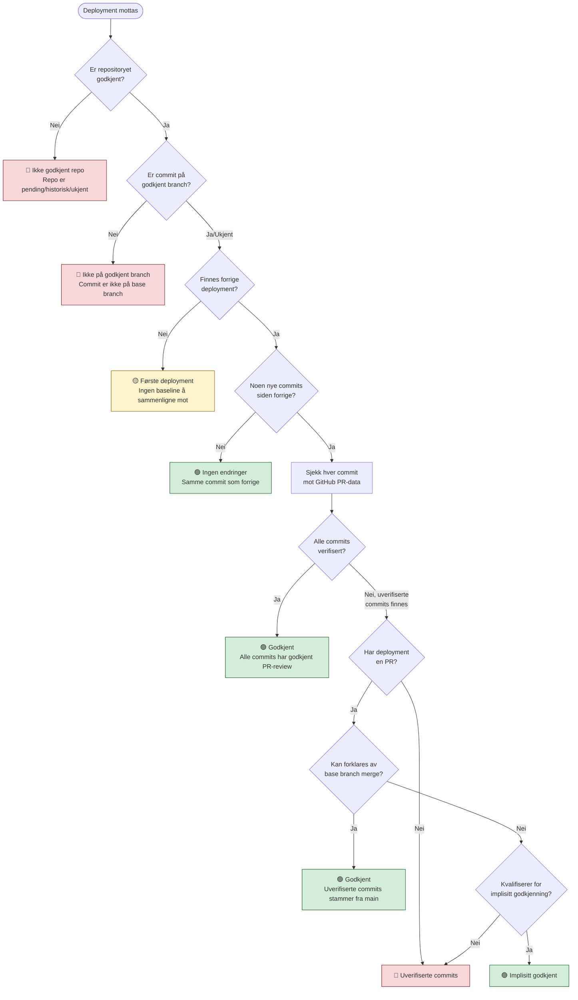

# Verifisering av fire-øyne-prinsippet

> **Målgruppe**: Utviklere, ledere og internrevisjon/kontrollere.
>
> **Formål**: Dokumentere hvordan Deployment Audit automatisk verifiserer at alle deployments til Nav sin Nais-plattform har hatt minst to personer involvert i kodeendringen (fire-øyne-prinsippet).

Lenker fra applisten til deploymentdetaljer bevarer opprinnelig listemodell i `listView=application|repository`, uavhengig av detaljsidens `view`. Begge detaljvisningenes tilbake-lenker gjenoppretter denne modellen med filtre og sidenummer bevart og fjerner `listView` fra liste-URL-en. Eldre detaljlenker uten gyldig `listView` går tilbake til appvisningen.

## Innholdsfortegnelse

- [Overordnet](#overordnet)
- [Beslutningsflyt](#beslutningsflyt)
- [Verifikasjonsresultater (statuser)](#verifikasjonsresultater-statuser)
- [Årsaker til manglende verifisering](#årsaker-til-manglende-verifisering)
- [PR-verifisering i detalj](#pr-verifisering-i-detalj)
- [Implisitt godkjenning](#implisitt-godkjenning)
- [Kodereferanser](#kodereferanser)
- [Ordliste](#ordliste)

---

## Overordnet

### Hva er fire-øyne-prinsippet?

Fire-øyne-prinsippet (four-eyes principle) betyr at minst **to personer** skal ha sett på en kodeendring før den settes i produksjon. I praksis betyr dette at:

1. Én person skriver koden
2. En annen person godkjenner koden (via en **pull request-review** på GitHub)

### Hva sjekker applikasjonen?

For hvert deployment sjekker systemet:

- Hvilke **commits** som er nye siden forrige deployment
- Om hver commit tilhører en **pull request** (PR) med godkjent review
- Om godkjenningen skjedde **etter siste commit** i PR-en (for å unngå at kode legges til etter godkjenning)
- Om den som godkjente er en **annen person** enn den som skrev koden

### Datakilder

Nye lagrede verifiseringskjøringer inneholder `result.comparisonRange` med full `baseSha` fra inputens forrige deployment og `headSha` fra deploymenten som vurderes. Begge endepunktene må være nøyaktig 40 heksadesimale tegn. Feltet er `null` når et endepunkt mangler, har annet format eller oppslaget etter forrige deployment feilet. Dette påvirker ikke verifiseringsstatusen. Formatsjekken bekrefter ikke at committene finnes i repositoryet. Intervallet dokumenterer input, ikke at sammenligningen lyktes eller at hele intervallet ble godkjent. Ingen intervalldata utledes fra dagens cache ved lesing.

Feltet lagres når ordinær verifisering eller reverifisering oppretter en ny rad i `verification_runs`. Reverifisering uten statusendring oppretter fortsatt ingen ny kjøring. Eldre resultater uten feltet beholdes uendret; ingen tilbakefylling eller endring av beslutningsalgoritmen inngår.

Full historikkhenting fra Nais returnerer først deploymentene når to påfølgende fullopplistinger har bestått kompletthetskontroll og har samme deployment-ID-sett uavhengig av rekkefølge. Hver opplisting må hente alle sider og ha konsistent `totalCount`, unike ikke-tomme deployment-ID-er, samsvar mellom antall unike ID-er og totalen, og gyldig cursor-/sidefølge. Ved ulike ID-sett hentes én tredje opplisting etter ett sekund; samsvar mellom andre og tredje sett godtas. Etter maksimalt tre opplistinger uten samsvar eller ved ufullstendig opplisting gir synken feil og bruker ikke delresultatene. En manglende applikasjon i Nais behandles som en ventende initialsynk, ikke som fullført. Når en full opplisting er behandlet, lagres `initial_nais_history_synced_at` på applikasjonen; markøren settes ikke ved manglende applikasjon eller feil under behandling.

Apper uten fullføringsmarkør får full historikkhenting ved neste periodiske synk, også når deploymentrader allerede finnes. Eksisterende rader hoppes ikke over i denne gjenopptakelsen: repositorystatus og tilhørende alerts behandles på nytt, mens deploymentraden ikke opprettes på nytt. Alertopprettelse ignorerer en alert med samme hendelsesidentitet, også når den historiske raden er manuelt løst; eksisterende alert- og løsningsdata endres ikke. Dette gjør at feil etter lagring av en deployment, men før repositorybehandlingen eller markøren, kan gjenopptas idempotent. Markøren settes først etter at alle deploymentene er behandlet av den aktuelle NAIS-synkjobben mens leasen er gyldig. NAIS-synkjobber forlenger en gyldig lease hvert fjerde minutt, og jobben rapporteres som fullført bare dersom den fortsatt eier en gyldig lease ved atomisk fullføring; en utdatert worker kan ikke fullføre markøren eller jobben. App-detaljsiden viser en advarsel mens initialsynken venter; synkjobben logger statusen, og feil under behandling registreres som feilet synkjobb.

Administratorer kan bruke **Gjenopprett Nais-historikk** fra administrasjonssiden til å nullstille markøren for én aktiv applikasjon. Neste periodiske synk starter full historikkhenting når eventuell pågående jobb og synkkjøling er ferdig. En slik replay kan gjenta repository-kontroller og varsler for eksisterende leveranser, men oppretter ikke duplikate deploymentrader. Verktøyet er avgrenset til én applikasjon per handling og krever eksplisitt bekreftelse.

Nais kan bruke samme deployment-ID for flere overvåkede applikasjoner. Oppslag og idempotent behandling av deploymentrader avgrenses derfor til applikasjonen, og databasen håndhever unikhet på kombinasjonen `(monitored_app_id, nais_deployment_id)`.

SHA-visningen på repositorysiden viser «Intervall fra siste verifiseringskjøring» per deployment. Intervallet hentes i ett samlet oppslag for sidens deployments fra siste kjøring etter `(run_at DESC, id DESC)`. Manglende eller ugyldig intervall vises som «Sammenligningsintervall ikke tilgjengelig», ikke som manglende dokumentasjon eller godkjenning av deploymenten. Det brukes ingen fallback til eldre kjøringer eller cache. Standardlisten er uendret.

Detaljsiden for en repository-leveranse viser også en skrivebeskyttet indikasjon på PR-review-dekning per commit. Den bruker bare lagrede GitHub-snapshots for det eksakte `base..head`-intervallet, commit-til-PR-koblinger og PR-metadata, commits, reviews og compare-resultater for stack-ancestry. Commit-til-PR-koblinger hentes og lagres paginert; eldre snapshots uten eksplisitt markering av fullstendig paginering behandles som ukjente. PR-head-SHA må samsvare med siste commit i commits-snapshotten, ellers regnes PR-evidensen som ukjent. Alle tilknyttede PR-er mot default-branch vurderes direkte. En PR mot en mellomliggende branch kan også vurderes når dens merge-commit er identisk med eller en forfar til en merget forelder-PRs head-commit, og forelderens egen merge-kjede når en merget PR mot default branch. Dette støtter også squash-merge av forelder-PR-en. Branch-navn eller base/head-SHA-likhet alene er ikke tilstrekkelig. Manglende PR-snapshot, fullført foreldresøk eller ancestry-snapshot gir ukjent resultat; et fullført søk som ikke finner en gyldig merge-kjede gir ikke dekning. Dokumentert gyldig dekning prioriteres, men hvis ingen dekker og minst én kandidat er ukjent, blir resultatet ukjent. En commit markeres som dekket når den eksisterende PR-review-sjekken godtar PR-en; eksplisitt og konfigurert implisitt PR-godkjenning følger samme funksjon som ved deployment-verifisering. Manglende snapshots, ukjent default-branch, ufullstendige sammenligninger eller commits som ikke kan knyttes sikkert til en PR gir ukjent resultat. Komplett lagret evidens som ikke oppfyller PR-review-sjekken vises som ikke dekket. Vurderingen kjører ikke GitHub-oppslag, modellerer ikke deployment-spesifikk `base_merge`-behandling, oppretter ingen repositorygodkjenning og endrer ikke deploymentstatus. Den er en utforskende evidensvisning, ikke en ny fire-øyne-beslutning.

Når forelder-PR-en merges først, kan barnets merge-commit i stedet dokumenteres gjennom parent-SHA-ene i leveransens komplette compare-snapshot. Barnets merge-commit må være en forfar til en annen dokumentert merge-commit fra en merget PR mot default branch i samme intervall. Både commit-til-PR-koblingen og PR-metadataene må bekrefte default branch for denne merge-commiten. At barnet bare finnes i en leveranse, eller bygger på en tidligere default-branch-commit, er ikke nok. Barnets egne commits og reviews vurderes fortsatt med de eksisterende PR-reglene. Denne vurderingen bruker allerede lagrede snapshots og krever ikke ny synkronisering.

Adminlisten for kodeleveranser viser oppfølging basert på samme forhåndsvurdering som detaljsiden: **Trenger manuell godkjenning**, **Ufullstendig grunnlag**, **Alle commits dekket** eller **Anker – ingen kodeendringer**. Gyldige manuelle delgodkjenninger teller med, mens tilbakekalte godkjenninger og endret author, identitet eller leveranseintervall ikke gir dekning. Manglende evidens eller identitetskobling skilles fra kjent manglende godkjenning. Administratorer med godkjenningsrettigheter får lenke til godkjenningssiden for leveranser med fullstendig grunnlag og udekkede commits.

Applikasjonens deploymentliste har én **Vis**-lenke per deployment som følger listens valgte vurderingsmodell. Detalj-URL-en bruker `view=application` eller `view=repository`, og `listView` bevarer modellen for tilbake-lenken; uten parameter, eller med ukjent verdi, beholdes applikasjonsvisningen. Visningsvalget endrer ikke gjeldende godkjenningsmodell. Den gamle `/deployments/:id`-inngangen videresender med parameterne bevart.

Appens deploymentliste støtter også `view=application|repository`, med appvisning som standard. Listen beholder én rad per deployment i begge modeller. Repositoryvisningen bruker samme intervall- og godkjenningsvurdering som detaljsiden og skiller **Alle commits dekket**, **Udekkede commits**, **Ufullstendig grunnlag**, **Mangler leveransekobling** og **Anker – ingen kodeendringer**. Anker betyr ikke at tidligere kode er godkjent. Statusfilteret bruker `repositoryStatus` i repositoryvisningen og `status` i appvisningen; begge beholdes ved bytte av visning, mens sidenummeret nullstilles. Appstatus brukes aldri til å filtrere repositorydekning. Øvrige filtre avgrenser deploymenthendelsene som før; metodefilteret beskriver fortsatt appmodellens metadata, ikke repositoryets reviewdekning. Detaljlenker og tilbake-lenker beholder visning og filtre.

Uten kodedekningsfilter bruker repositoryvisningen ordinær databasepaginering og vurderer bare deploymentene på valgt side. Med kodedekningsfilter må hele utvalget vurderes for korrekt antall treff og paginering. Da leses deployments i puljer på 100 med cursor på `(created_at, id)` uten gjentatte totaltellinger eller økende OFFSET. Cursorens tidspunkt hentes direkte fra databasen uten tap av presisjon i JavaScript. Begge lesemåter bruker én skrivebeskyttet repeatable-read-transaksjon og vurderer unike koblede leveranser samlet per repository på samme forbindelse. Det beregnes ikke separate kategoriantall. Bare den valgte sidens sammendrag sendes til klienten. Lesingen gjør ikke GitHub-kall, lagrer ikke statuser og kobler ikke automatisk fra SHA-treff. Kilde- og branchkontroller inngår ikke i kodedekningsmerket og henvises til den separate applikasjonsbaserte vurderingen. Repositoryvisningen sammenligner tilgjengelig grunnlag nå og aktiverer ikke ny modell i rapporter, varsler eller godkjenningshandlinger.

Repositoryvisningen bruker en egen lesetjeneste og den lagrede `repository_code_delivery_id`-koblingen, med kontroll av repository-ID og full head-SHA. Den viser repositoryleveransens låste intervall og vurdering per commit som hovedinnhold. Kodedekning beregnes med samme vurdering som repositoryets adminvisning, inkludert gyldige manuelle delgodkjenninger. Det relevante er om koden er godkjent, uavhengig av om godkjenningen skjedde før eller etter deployment. Kilde- og branchkontroller overstyres ikke; de leses i den separate appvisningen. Ingen samlet ny deploymentstatus beregnes. Tittel, tidspunkt og tekniske deployment-/PR-detaljer leses separat fra vurderingen; de endrer ikke vurderingsresultatet.

Repositorybasert deploymentdetalj gjenbruker appdetaljens visningsvalg, tilbake-lenke, tittel, tekniske detaljer og PR-/checks-visning. Tittelen bruker samme diff-grunnlag som appdetaljen (forrige tellende deployment nå). Sammenligningslenken bruker repositoryleveransens låste base-SHA og merkes «Endringer i repositoryleveransen». Applikasjonsvurderingen og dens commitliste vises bare i appvisningen, som er tilgjengelig via visningsvelgeren. Nais Apply er aktivt for alle overvåkede apper, og Apply-deployments følger samme synlighetsregler som øvrige deploymentkilder. Brukermappinger hentes for deployer, repositoryets commitforfattere og PR-deltakere. Repositoryvurderingen, intervallene og godkjenningslenken er fortsatt egne og endrer ikke appdetaljens rendering eller status.

Manglende leveransekobling vises eksplisitt, med dokumentert årsak når den finnes. Et treff på samme stabile repository-ID og head-SHA uten lagret kobling merkes som mulig match og brukes ikke til dekning. Ufullstendig repositorygrunnlag vises eksplisitt. Selve repositoryvurderingen leses i én skrivebeskyttet repeatable-read-transaksjon, gjør ingen GitHub-kall og oppretter eller reparerer ikke koblinger. Den separate detaljvisningen returnerer bare feltene som brukes i den felles deployment-/PR-presentasjonen; den kan inneholde lagrede PR-detaljer, men ikke repositorygodkjenningens kommentarer eller identitetsversjoner. Repositoryvisningen tilbyr ikke forrige/neste-navigasjon basert på applikasjonsfiltre. Den har ingen mutasjonsskjemaer, og POST med `view=repository` avvises av den delte deploymenthandlingen. Godkjennere kan følge en separat lenke til den eksisterende repositorygodkjenningen. Dagens appbaserte godkjenningsflyt er ellers uendret.

Genererte deploymentlenker i repositoryvisningen bruker repositoryets nåværende navn når det finnes. Manglende repositoryidentitet gir tekst i stedet for repositoryavhengige lenker. Titteloppslaget bruker fortsatt deploymentets registrerte navn.

Ufullstendig repositoryvurdering vises som **Uavklart grunnlag** med antall dekkede, udekkede og uavklarte commits. Manglende commit-historikk vises separat. Ved ukjent PR-dekning beholdes den konkrete årsaken fra intervallvurderingen, for eksempel manglende PR-snapshot eller ukjent default-branch. Visningen forklarer hva som må undersøkes, og brukere med repositoryadministrasjon får lenke til leveransens review-grunnlag og innlesingsstatus. Ukjent grunnlag gir ikke tilgang til manuell godkjenning som om det bare manglet en godkjenning. Dette endrer verken vurderingsresultatet eller den applikasjonsbaserte vurderingen.

For botcommits uten PR-dekning viser repositorydetaljen den konkrete PR-årsaken i stedet for å be om kobling til NAV-ident. Veiledningen peker til PR-godkjenningen og repositoryets innstilling for implisitt godkjenning. Botkontoer skal ikke kobles til NAV-ident. Presentasjonen endrer ikke vurderingsstatusen, aktiverer ikke implisitt godkjenning og godkjenner ikke botcommits automatisk.

Repositoryets PR-vurdering godtar eksplisitt review som dekker siste relevante commit uavhengig av implisitt godkjenningsmodus. En merget PR kan også få implisitt dekning uten et godkjent review, med appflytens eksisterende regelhjelper: «Kun Dependabot» krever Dependabot som PR-oppretter og forfatter av alle commits samt en annen merger; «Alle» krever at merger verken er PR-oppretter eller siste commitforfatter. Manglende eller ufullstendige snapshots gir fortsatt uavklart grunnlag. Appvurderingen og repositoryinnstillingene endres ikke.

Analyseeksportens schema 6 inkluderer `repositoryAssessments` for de registrerte leveransene i uttrekket. Hver leveranse får aktuell intervallvurdering og godkjenningsvurdering, normalisert vurderingsgrunnlag med default-branch og implisitt godkjenningsmodus, aktive author-identiteter, manuell godkjenningshistorikk og innlesingsstatus. `snapshotReferences` og `snapshots` viser de eksakte råsnapshotene brukt av intervallvurderingen: compare, commit–PR-koblinger, PR-metadata, commits, reviews og ancestry for stablede PR-er. Alt leses i eksportens eksisterende read-only repeatable-read-transaksjon. Manglende køoppføring vises som `assessmentSync: null`; manglende grunnlag beholdes som uavklart, ikke som tom GitHub-reviewhistorikk. Disse aktuelle repositoryvurderingene er separate fra appmodellens lagrede `verificationRuns` og live-oppslag fra GitHub. Eksporten endrer ingen vurderinger, innstillinger eller synktilstand.

Oppfølgingsfilteret og antall per kategori gjelder alle repositoryets kodeleveranser, ikke bare siden som vises. Serveren leser leveransene i valgt sorteringsrekkefølge og vurderer lagret evidens, manuelle godkjenninger og aktive identiteter i én skrivebeskyttet repeatable-read-transaksjon, i puljer på opptil 100 leveranser. Sammendrag, uavklarte deployments og historisk innlesingsgrunnlag bruker samme databaseforbindelse og snapshot. Filtrering skjer før paginering. Dette krever vurdering av hele repositoryhistorikken ved sidevisning; det gjøres ingen GitHub-kall og ingen lagrede statusbeslutninger introduseres. Historisk innlesingsgrunnlag ligger sammenlagt under leveranselisten.

Leveransedetaljsiden viser i tillegg en **skrivebeskyttet forhåndsvurdering av repositorygodkjenning**. Den kombinerer PR-dekningen over med gyldige lagrede manuelle delgodkjenninger i den rene intervall-evaluatoren fra `repository-code-delivery/approval-assessment.ts`. Manuell dekning krever en aktiv mapping fra GitHub-kontoen oppgitt som commit author til en aktiv NAV-ident, uendrede konto-/brukerversjoner og en annen reviewer enn author. Tilbakekalte delgodkjenninger gir ikke dekning. GitHubs commit author-identitet kommer fra commit-metadata og fastslår ikke hvem som opprettet eller pushet commiten; denne tillitsbegrensningen gjelder også manuell dekning. Ufullstendig compare-historikk, ukjent PR-grunnlag eller manglende aktiv identitetsmapping for en commit som trenger manuell godkjenning gir ukjent vurdering, aldri godkjenning. Evidens, identiteter og godkjenningshistorikk leses i samme databasesnapshot. Visningen viser historiske author-identiteter og tilbakekallinger, men tilbyr ingen skrivehandlinger, lagrer ingen beslutning og endrer ikke deploymentstatus. Gamle deploymentgodkjenninger importeres ikke.

| Kilde | Hva hentes | Når |
|-------|-----------|-----|
| **Nais API** | Legacy deployments (app, tidspunkt, commit-SHA, miljø) | Periodisk hvert 5. minutt |
| **Nais API (Nais Apply)** | `spec.image`-endringer fra aktivitetsloggen; GitHub-run `head_sha` hentes og kontrolleres mot repository-ID og run attempt | Periodisk for alle overvåkede apper |
| **GitHub API** | Commits mellom deployments, PR-metadata, reviews, godkjenninger, check runs | Ved verifisering av hvert deployment |
| **GitHub API (repo metadata)** | `default_branch` for hver overvåket app | Periodisk, maks én gang per app per 24 timer |

#### Auto-deteksjon av default_branch

`monitored_applications.default_branch` brukes til å filtrere PR-er ved verifisering — kun PR-er med `base.ref` som matcher denne verdien telles. For å unngå feilkonfigurasjon (f.eks. konfigurert `main` mens repoet faktisk bruker `master`) hentes feltet fra GitHub som del av synkroniseringssyklusen, med 24t cooldown per app. Når **deployment-commiten selv** ikke har en tilknyttet PR mot konfigurert default-branch, og GitHub i stedet returnerer en PR mot en annen branch, vises en advarsel («Mulig feil-konfigurert default-branch») på deployment-detaljsiden inntil neste sync har korrigert verdien. Advarselen vises kun basert på deployment-commitens PR — ikke basert på enkeltcommits i rekken mellom to deployments. Dette er fordi commits legitimt kan ha gått gjennom en testbranch (f.eks. sandbox) på vei til main uten at appens konfigurasjon er feil.

#### Prinsipp: GitHub er eneste autoritative kilde ved verifisering

`monitored_applications.default_branch` og andre DB-cachede verdier kan være foreldet — f.eks. om et repo har omdøpt default-branchen etter sist synkronisering. **Branch-relaterte data som lagres på et deployment (f.eks. `branch_name`) må alltid hentes direkte fra GitHub ved verifiseringstidspunktet**, ikke utledes fra cachede DB-verdier.

I praksis betyr dette:
- `detectedBranchName` hentes fra `deployedPr.metadata.headBranch` (GitHub PR API) eller `getBranchFromWorkflowRun()` (GitHub Actions API) — begge direkte fra GitHub ved verifisering
- `baseBranch` fra DB skal **ikke** brukes som kilde for `branch_name`, selv om `commitOnBaseBranch === true`, fordi verdien kan reflektere en annen branch enn den som faktisk var default på deployment-tidspunktet

### Prosessflyt på overordnet nivå

```
Nais API → Legacy deployments og Nais Apply-endringer oppdages → Lagres med kildeidentitet
                                            ↓
                                    Apply uten verifiserbar SHA → "Ikke sporbar" (kan ikke auto-godkjennes)
                                    GitHub API → Hent commits og PR-data for verifiserbare SHA-er
                                            ↓
                                    Verifiseringslogikk → Bestem status
                                            ↓
                                    Resultat lagres i database
```

Nais Apply-aktiviteter uten `environmentName` lagres rått, men materialiseres ikke som leveranser. Flere image-endringer grupperes bare når `repositoryID`, `runID`, `runAttempt` og `checkRunID` identifiserer samme GitHub Actions-jobb og den nye image-verdien er lik. Hendelser uten en komplett grupperingsnøkkel beholdes som separate leveranser; lik actor eller tidsnærhet er ikke nok til å slå dem sammen. `workflowSha` brukes aldri som levert commit-SHA. Hvis Actions-run-data ikke kan bekrefte repository-ID, run attempt og `head_sha`, opprettes leveransen med status `unverifiable`, som er ikke-godkjent og ikke automatisk verifiserbar.

Den første komplette Apply-historikksynken undertrykker Slack-varsler for materialiserte Apply-leveranser. Nye hendelser fra senere pollinger følger eksisterende Slack-varslingsinnstillinger.

Nais Apply synkroniseres parallelt med legacy for alle overvåkede apper og kan ikke slås av separat. Synkstatus og feil vises i appadministrasjonen.

Apply-logghenting bruker deploymentets repository-ID til å finne gjeldende GitHub-navn. Loggarkivet bruker deploymentets opprinnelige repositorynavn som nøkkel ved både lagring og lesing, slik at rename ikke endrer arkivnøkkelen. Uavklart identitet blir ikke markert som ferdig cachet. Søskenpropagering avgrenses til kildedeploymentets repository, og cachet reverifisering og diff-forhåndsvurdering bruker faktisk repositorystatus, også for historiske koblinger.

Etter førstegangsinnhentingen materialiseres bare nye aktiviteter og aktiviteter med uavklart GitHub-SHA eller repositorytilknytning som er klare for nytt forsøk etter fem minutter. Ferdigbehandlet historikk materialiseres ikke på nytt ved hver polling. Eldre medlemmer av berørte bildegrupper hentes inn slik at forsinkede hendelser fortsatt kan korrigere gruppens første tidspunkt. Behandlingsstatus lagres først etter at materialisering og tilhørende varsler er fullført, slik at avbrutte forsøk kan gjenopptas.

---

## Beslutningsflyt

Når et deployment skal verifiseres, går systemet gjennom følgende beslutningstrinn:



### Steg-for-steg forklaring

#### Steg 0: Er repositoryet godkjent?

Før noen annen verifisering sjekkes om deploymentets repository er registrert og godkjent (`active`) for applikasjonen. Hvis repositoryet har status `pending_approval`, `historical`, eller ikke er registrert i det hele tatt (`unknown`), avvises verifiseringen umiddelbart med status **`unauthorized_repository`**. Dette forhindrer at deployments fra uautoriserte kilder kan bli markert som godkjent.

> 📁 Se `handleUnauthorizedRepository` i [`verify.ts`](../app/lib/verification/verify.ts) og `findRepositoryForApp` i [`application-repositories.server.ts`](../app/db/application-repositories.server.ts)

#### Steg 0b: Er commit på godkjent branch?

Systemet bruker GitHub Compare API til å sjekke om den deployede commit-SHAen befinner seg på applikasjonens konfigurerte base-branch (f.eks. `main`). Hvis committen **ikke** er på base-branchen, betyr det at noen har deployet fra en feature-branch eller annen uautorisert branch. Status: **`unauthorized_branch`**.

Hvis API-kallet feiler (f.eks. midlertidig nettverksproblem), fortsetter verifiseringen normalt (**fail-open**) — det er bedre å sjekke fire-øyne enn å blokkere alt.

> 📁 Se `handleUnauthorizedBranch` i [`verify.ts`](../app/lib/verification/verify.ts) og `isCommitOnBranch` i [`github.server.ts`](../app/lib/github.server.ts)

#### Steg 1: Finnes forrige deployment?

Hvis dette er **første gang** applikasjonen deployes (ingen tidligere deployment i databasen), kan vi ikke vite hvilke commits som er nye. Deploymentet får status **`pending_baseline`** — det fungerer som referansepunkt for fremtidige deployments.

> **Merk:** Legacy-deployments (importert historikk med ugyldige commit-referanser som `refs/heads/...`) filtreres bort ved søk etter forrige deployment. Første deployment etter legacy-perioden behandles derfor som `pending_baseline`.
>
> `audit_start_year` filtrerer **ikke** søket etter forrige deployment — ancestry-oppslaget søker uavhengig av revisjonens startår, både ved live verifisering og pre-beregningen av verifiseringsavvik (`compute-diffs`). `audit_start_year` bestemmer kun hvilke deployments som er innenfor revisjonens formelle omfang (f.eks. hvilke deployments som vises/telles i revisjonsstatistikk og hvilke det faktisk kreves godkjenning for), ikke hvilke deployments som er tilgjengelige som referansepunkt. Søket er likevel begrenset av `MAX_CANDIDATE_PAGES` (for tiden 50 sider à 20 kandidater, altså maks 1000 kandidater) — deployments eldre enn denne grensen kan ikke brukes som referansepunkt selv om de ligger utenfor revisjonens startår.

**Repo-basert forrige-leveranse (monorepo-støtte):** Forrige deployment finnes ved å søke på tvers av **alle** applikasjoner som deler samme GitHub-repo (identifisert med det stabile `github_repo_id`, ikke `(owner, repo)`-strengen), uavhengig av hvilket miljø de kjører i og uavhengig av `monitored_app_id`. Dette dekker både det vanlige tilfellet (ett repo → én app) og monorepo-tilfellet (flere apper produksjonssettes uavhengig fra samme repo) med samme spørring — en «vanlig» app er i denne modellen bare et monorepo med én applikasjon.

Siden NDA kun følger opp applikasjoner i produksjon, gjøres **ikke** noe skille mellom miljøer (f.eks. `prod-fss` og `prod-gcp`) i dette søket.

**Delt `audit_start_year` for hele repoet:** Selv om `audit_start_year` ikke lenger filtrerer forrige-leveranse-søket (se over), er den fortsatt normalisert per repo i databasen: tabellen `repositories` (nøklet på `github_repo_id`) er kilden til sannhet for `audit_start_year`, `implicit_approval_mode` og `default_branch`. Alle apper som deler samme `github_repo_id` leser dermed de samme verdiene for revisjonens formelle omfang, og et monorepo kan ikke lenger få ulike regler per app.

**Effektive verdier og fallback:** Verifiseringen bruker *effektive* innstillinger, ikke kolonnene på `monitored_applications` direkte. Fallback-regelen er ulik per felt:

| Felt | Kilde når repoet er koblet (`repositories`-rad finnes) | Kilde når repoet ikke er koblet ennå |
|------|--------------------------------------------------------|----------------------------------------|
| `audit_start_year` | `repositories.audit_start_year` alltid — også når den er `NULL` (betyr «ingen nedre grense» for hele repoet, ikke «ufastsatt») | `null` (ingen fallback — uten kjent repository finnes ingen kode å revidere) |
| `implicit_approval_mode` | `repositories.implicit_approval_mode` (aldri NULL) | `'off'` (ingen fallback — implisitt godkjenning krever et kjent repository) |
| `default_branch` | `repositories.default_branch`, med fallback til `monitored_applications.default_branch` hvis NULL | `monitored_applications.default_branch` |

`audit_start_year` og `implicit_approval_mode` faller **ikke** tilbake til app-nivå-kilder i det hele tatt lenger — verken når repoet er koblet (der ville det undergravd garantien om at alle apper i repoet vurderes med identiske regler) eller når repoet mangler (uten kjent repository er det ikke noe kode å revidere eller godkjenne, så innstillingene kan heller ikke settes på app-nivå). Admin-UI for disse feltene viser en informasjonsboks i stedet for skjemaet når appen ikke har en koblet repository. `default_branch` faller derimot fortsatt tilbake per app, fordi NULL der kun betyr «ikke synket fra GitHub ennå», ikke et bevisst valg, og fordi `application_repositories.github_repo_id` fylles asynkront.

Endringer gjøres via `updateRepositorySettings` i [`repositories.server.ts`](../app/db/repositories.server.ts): den oppdaterer `repositories`, logger til `repo_config_audit_log`, og kjører baseline-rekalkulering (`pending_baseline`/`baseline`) for hele repo-scopet når `audit_start_year` endres. Alle apper som deler samme `github_repo_id` henter *effektive* innstillinger via `getEffectiveSettingsForApp(s)` — det finnes ingen separat per-app-kopi av `audit_start_year`/`implicit_approval_mode` å speile ned til lenger (kun `default_branch` har fortsatt en per-app-fallback, se tabellen over). **Selve beslutningsalgoritmen i `verify.ts` er uendret** — kun kilden til `auditStartYear` og `implicitApprovalSettings` er flyttet.

Fase 0s `audit_year_mismatch`-varsel er dermed en ren informasjons-/oppdagelsesmekanisme for apper som ennå ikke er koblet til en `repositories`-rad.

> 📁 Se `getEffectiveSettingsForApp` og `updateRepositorySettings` i [`repositories.server.ts`](../app/db/repositories.server.ts), SQL-fragmentene i [`repository-settings-sql.ts`](../app/db/repository-settings-sql.ts), `applyAuditStartYearChangeForApps` i [`audit-start-year-baseline.server.ts`](../app/db/audit-start-year-baseline.server.ts), og `canAccessRepositorySettingsAdmin` i [`authorization.server.ts`](../app/lib/authorization.server.ts) (autorisasjonssjekken kaskaderer på samme måte, slik at en admin må ha tilgang til *alle* apper i repoet for å kunne endre repo-nivå-innstillingene).

Kandidatene sorteres etter tidsstempel (nyeste først). Hver kandidat bekreftes med en **ancestry-sjekk** mot GitHub (`compareCommits`) før den godtas som forrige leveranse — kandidaten må faktisk ligge bakover i commit-historien til den nåværende deploymentens commit (`status = 'identical'` eller `'ahead'`). Dette gjelder også når søket returnerer **kun én** kandidat (regnes fortsatt som ett billig `compareCommits`-kall), slik at en enkelt kandidat som ikke lenger er en forfar (f.eks. etter force-push eller historie-omskriving) ikke feilaktig godtas. Hvis søket returnerer **flere** kandidater (typisk i et monorepo hvor flere apper har deployert på ulike tidspunkt), går systemet fra nyeste til eldste kandidat til en bekreftet forfar er funnet.

Hvis en kandidat viser `status = 'diverged'` (commiten er **ikke** en forfar — typisk tegn på force-push, som ikke støttes i NDA, eller en direkte deploy fra en ikke-merget gren), ekskluderes kandidaten fra søket og hendelsen logges strukturert som `history_anomaly` for overvåking. Søket fortsetter til neste eldre kandidat i stedet for å stoppe helt. Hvis ingen kandidat kan bekreftes som forfar, får deploymentet status **`pending_baseline`** i stedet for å falle tilbake på nyeste-etter-tid.

> 📁 Se `getPreviousDeployment` i [`previous-deployment.server.ts`](../app/lib/verification/fetch-data/previous-deployment.server.ts) og `getCommitAncestryStatus` i [`git.server.ts`](../app/lib/github/git.server.ts)

#### Steg 2: Er det noen nye commits?

Systemet henter listen over commits mellom forrige deployment sin commit-SHA og nåværende deployment sin commit-SHA via GitHub API.

> **Viktig:** `no_changes` betyr kun at det ikke finnes nye commits å diffe mot forrige deployment — det er **ikke** i seg selv en godkjenning. Hvis PR-en som ble deployet (`deployedPr`) er tilgjengelig, kjører systemet likevel den vanlige four-eyes-sjekken mot den før status settes. Er PR-en ikke four-eyes-godkjent (f.eks. selvgodkjenning), returneres status **`unverified_commits`** med `hasFourEyes: false` i stedet for å arve en eventuell tidligere (feilaktig) godkjent status. Dette hindrer at en re-deploy av en commit som opprinnelig ble feilverifisert, fortsetter å vises som godkjent for alltid. Er PR-en derimot four-eyes-godkjent, avhenger sluttresultatet av hvilken app forrige deployment (med samme commit-SHA) tilhører: tilhører den **samme app**, er dette en genuin re-deploy av uendret kode — status forblir `no_changes`. Tilhører den derimot en **annen app** (`monitored_app_id`) i samme repo, er dette en reell leveranse til produksjon for *denne* appen (f.eks. en delt biblioteksendring i et monorepo), og status settes i stedet til **`approved`** (metode `pr_review`) eller **`implicitly_approved`** (metode `implicit`) avhengig av hvilken vei `verifyFourEyesFromPrData` faktisk godkjente PR-en gjennom — se «Samme commit-SHA (re-deploy)» under for detaljer. Hvis `deployedPr` derimot **ikke** er tilgjengelig (f.eks. direkte push uten PR, eller PR-oppslaget feilet), kan denne re-sjekken ikke utføres i det hele tatt: tilhører forrige deployment samme app, beholder deploymentet status `no_changes` med `hasFourEyes: true` som før, men tilhører den en annen app med samme commit-SHA, går verifiseringen i stedet videre til sibling-grenen (`verified_via_sibling`/`pending_sibling_resolution`, se under).

##### Samme commit-SHA (re-deploy)
- Deploymentet er en **re-deploy** av eksakt samme kode **i samme app** (samme `monitored_app_id`). Status: **`no_changes`**.
- Hvis den forrige deploymentet med samme commit-SHA derimot tilhører en **annen app** (`monitored_app_id`) i samme repo — typisk i et monorepo der flere apper deployes fra samme push — er dette **ikke** en re-deploy for denne appen, men første gang *denne* appen ser commiten.
  - Har *denne* deploymentets egen PR (`deployedPr`) allerede four-eyes-godkjenning, godkjennes den **direkte** derfra, uavhengig av søskenapplikasjonens status: kom godkjenningen fra en genuin PR-review, settes status **`approved`** (metode `pr_review`, godkjennere hentet fra PR-reviewene); kom den derimot fra implisitt godkjenning (f.eks. Dependabot-regelen, godkjenning før siste commit + kvalifiserende merger), settes status **`implicitly_approved`** (metode `implicit`) i stedet, slik at klassifiseringen fra `verifyFourEyesFromPrData` bevares korrekt. Dette reflekterer at endringen faktisk ble reviewet/godkjent på GitHub for denne konkrete leveransen, i stedet for den mer indirekte `verified_via_sibling`-statusen under.
  - Har deploymentet derimot **ingen egen PR-data** (`deployedPr` er `null`, f.eks. fordi PR-oppslaget feilet eller det er en direkte push), kan koden ikke verifiseres direkte fra egen PR, og systemet faller tilbake på at koden allerede er verifisert via søskenapplikasjonens deployment. Status: **`verified_via_sibling`**, forutsatt at søskenapplikasjonens deployment selv har en *genuint rot-godkjent* status (se under). Er søskenapplikasjonens deployment ikke selv godkjent ennå (f.eks. `pending`, `error`, `unverified_commits`), eller er dets status selv `verified_via_sibling` (dvs. en avledet, ikke-rot status — se rot-attribuering under), godtas det ikke som verifiseringskilde — status settes i stedet til **`pending_sibling_resolution`** (en tydelig, ikke-feilaktig venteststatus — se [Verifikasjonsresultater](#verifikasjonsresultater-statuser)), og verifiseringen forsøkes på nytt senere når søskenapplikasjonen er løst. Dette hindrer at en uverifisert eller ikke-rot sibling kan «godkjenne» denne appen, som deretter propagerer tilbake og «godkjenner» søskenapplikasjonen i en sirkel.
  - Begge disse grenene krever i tillegg at det faktisk er samme commit-SHA på begge sider (`input.commitSha === previousDeployment.commitSha`) — `handleNoChanges` brukes også for ancestor/nearby-deploy-tilfeller der SHA-ene bevisst er ulike, og de skal aldri klassifiseres som `approved` eller sibling-verifisering selv om forrige deployment tilhører en annen app og deploymentets egen PR er godkjent.
- **Rot-attribuering ved kjeding:** Hvis flere apper i samme repo deployer samme commit på ulike tidspunkt (f.eks. app A → B → C), skal `verified_via_sibling` alltid peke på den appen som faktisk ble reelt godkjent (roten), ikke på nærmeste mellomledd i kjeden. `verified_via_sibling` er selv en avledet status og teller derfor **ikke** som gyldig rot — systemet gjør et eget, avgrenset oppslag (`findRootApprovedSiblingForCommit`) på tvers av **alle** apper i repoet (typisk et fåtall), inkludert appen som selv verifiseres nå, for samme commit-SHA, og velger den eldste appen med en genuint rot-godkjent status (`approved`, `approved_pr`, `implicitly_approved`, `manually_approved`, `baseline` eller `no_changes`). Hvis C ellers ville blitt attribuert til B (fordi B er nærmest i tid), blir den i stedet attribuert direkte til A. Oppslaget kan også løse et annet tilfelle: hvis app A redeployer en commit den selv fikk godkjent tidligere, men en søskenapplikasjon i mellomtiden har deployet samme commit (og dermed blitt den nærmeste `previousDeployment`-kandidaten), finner oppslaget A sin egen, eldre rot-godkjente deployment — og resultatet blir korrekt attribuert til A selv, slik at dette forblir en ordinær `no_changes`-redeploy i stedet for en uløst sibling-verifisering. Oppslaget er i tillegg begrenset til deployments som allerede eksisterte **før** deploymentet som verifiseres (`d.id <= gjeldende deployment-id`, deployment-id er en monotont stigende SERIAL-PK), slik at en søster som blir godkjent *senere* aldri kan bli valgt som rot og retroaktivt godkjenne en eldre deployment.

  > 📁 Se `findRootApprovedSiblingForCommit`/`preferRootApprovedSibling` i [`previous-deployment.server.ts`](../app/lib/verification/fetch-data/previous-deployment.server.ts)

##### Samme commit-SHA men GitHub compare returnerer 'identical'
- Hvis GitHub compare-API returnerer `status = 'identical'`, bekrefter det at begge commitene er identiske. Status: **`no_changes`** (eller **`approved`**/**`implicitly_approved`**/**`verified_via_sibling`** hvis forrige deployment tilhører en annen app, se over).

##### Forskjellig commit-SHA — no-diff-deteksjon

Når GitHub compare returnerer 0 commits til tross for ulike SHAer, bruker systemet **compare-metadata** og en **tree-comparison-fallback** for å skille ekte «ingen diff» fra rollback, branch-divergens og API-feil:

**Steg 1: Tree-comparison-fallback (for ambigøse tilfeller)**
- Hvis begge commits har **identiske commit trees** (`tree.sha` match) → **Ekte no-diff** ✓
  - Eksempel: To brancher som ble opprettet fra samme commit, deretter rebased eller reordered, men som nå peker på kode med samme tree
- Hvis **tree-sjekken finner ulik trees** eller **feiler** → Fortsett til steg 2

**Steg 2: Sjekk nærliggende godkjente deployments (for rollback-scenario)**

Hvis ingen av stegene over bekreftet no-diff:
1. **Nærliggende deployment med samme commit-SHA** (±30 min, samme applikasjon) som allerede er godkjent → behandles som retry/duplikat, status: **`no_changes`**.
2. **Nærliggende deployment med annen commit-SHA** (±30 min, samme applikasjon) som er godkjent → mulig *superseded deploy* (heuristikk, ikke ancestry-verifisert), status: **`no_changes`**. Typisk ved rapid-fire deploys der webhook-rekkefølge ikke matcher merge-rekkefølge.
3. Ingen nærliggende godkjent deployment → Status: **`error`**. Krever manuell vurdering.

> «Nærliggende deployment» er alltid begrenset til **samme `monitored_app_id`** — apper som deler samme GitHub-repo og miljø (f.eks. flere apper bygget fra samme monorepo), men som ikke er eksplisitt koblet sammen i en applikasjonsgruppe, kan ikke referere til hverandres deploymentrekke.

**Når returneres error?**
- `compareFailed = true` → GitHub compare API feilet (403 Forbidden, 404 Not Found, 500, osv.). Status: **`error`** — GitHub App må sjekkes.
- Ulike SHAer, 0 commits, og `noDiffDetected = false` → Trolig rollback eller branch-divergens med faktisk kodeendringer. Status: **`error`** — krever manuell vurdering.

#### Steg 3: Sjekk hver commit individuelt

For hver commit mellom forrige og nåværende deployment:

1. **Base-branch merge-commits** hoppes over (`Merge branch 'main' into ...`) — disse bringer allerede verifisert kode inn i feature-branchen
2. **Andre merge-commits** (f.eks. `Merge branch unapproved-feature`) verifiseres som vanlige commits — de kan inneholde kodeendringer fra konfliktløsning
3. **Commit i deployed PR**: Hvis commiten tilhører PR-en som ble deployet, sjekkes den PR-ens godkjenningsstatus
4. **Commit med egen PR**: Hvis commiten har en tilknyttet PR (f.eks. en squash-merge fra en annen branch), sjekkes den PR-ens godkjenningsstatus
5. **Commit dekket av merge-commit-PR**: GitHub's commit→PR API returnerer ikke alltid alle PR-er for en gitt SHA — typisk skjer dette når en commit var på en testbranch (f.eks. sandbox) og ble merget til main via en annen PR. Hvis commiten inngår i commit-listen til en PR-merge-commit som finnes i samme deployment-rekke, verifiseres den via den PR-ens godkjenningsstatus.
6. **Commit uten PR**: Commiten er pushet direkte til main uten PR — dette er en **direkte push** og kan ikke verifiseres automatisk

#### Steg 4: Alle commits verifisert?

Hvis alle ikke-merge commits har en godkjent PR-review → status **`approved`**.

#### Steg 5: Base branch merge?

Noen ganger har en PR commits som ikke ble reviewet, men som stammer fra at utvikleren har merget `main` inn i sin feature-branch for å holde den oppdatert. Systemet sjekker:

- Finnes det en merge-commit som bringer `main` inn i feature-branchen?
- Er alle uverifiserte commits datert **før** denne merge-commiten?
- Har PR-en minst én godkjent review?

Hvis ja → status **`approved`** (med metode `base_merge`).

#### Steg 6: Implisitt godkjenning?

For visse typer PR-er kan selve **merge-handlingen** fungere som den andre personen sin godkjenning. Se [Implisitt godkjenning](#implisitt-godkjenning) for detaljer.

#### Steg 7: Uverifiserte commits

Hvis ingen av stegene over fører til godkjenning, forblir deploymentet **uverifisert**. Hver uverifisert commit får en spesifikk årsak (se [Årsaker til manglende verifisering](#årsaker-til-manglende-verifisering)).

---

## Verifikasjonsresultater (statuser)

Hvert deployment får én av følgende statuser etter verifisering:

| Status | Norsk navn | Godkjent? | Beskrivelse |
|--------|-----------|-----------|-------------|
| `approved` | Godkjent | ✅ Ja | Alle commits har godkjent PR-review |
| `implicitly_approved` | Implisitt godkjent | ✅ Ja | Godkjent via implisitte regler (f.eks. Dependabot) |
| `no_changes` | Ingen endringer | ✅ Ja | Re-deploy av eksakt samme commit **i samme app**, eller compare/tree bekrefter at det ikke finnes kodeendringer. Hvis en tilgjengelig `deployedPr` viser at PR-en ikke er four-eyes-godkjent, returneres i stedet `unverified_commits` |
| `verified_via_sibling` | Verifisert via søskenapplikasjon | ✅ Ja | Samme commit-SHA er allerede godkjent via en **annen apps** deployment i samme repo (monorepo). Krever at søskenapplikasjonens deployment selv har en godkjent status — hvis ikke, returneres `pending_sibling_resolution` i stedet |
| `pending_baseline` | Første deployment | ⚠️ Nei | Første deployment — brukes som referansepunkt |
| `unverified_commits` | Uverifiserte commits | ❌ Nei | Én eller flere commits mangler godkjent PR-review |
| `unauthorized_repository` | Ikke godkjent repo | ❌ Nei | Deploymentets repo er ikke godkjent for applikasjonen |
| `unauthorized_branch` | Ikke på godkjent branch | ❌ Nei | Deployet commit er ikke på konfigurert base-branch |
| `manually_approved` | Manuelt godkjent | ✅ Ja | Manuelt godkjent av administrator i applikasjonen |
| `legacy` | Legacy | ⚠️ N/A | Deployment fra før audit-systemet ble aktivert |
| `error` | Feil | ❌ Nei | Teknisk feil under verifisering, eller tvetydig compare med ulike commit-SHAer og reell diff/branch-divergens |
| `pending_sibling_resolution` | Venter på søskenapplikasjon | ⚠️ Nei | Samme commit-SHA er deployet av en søskenapplikasjon i samme repo, men den er ikke selv rot-godkjent ennå. Ikke en teknisk feil — løser seg selv (via `verified_via_sibling`) når søskenapplikasjonen godkjennes, og re-verifiseres automatisk i mellomtiden |

> **Koderef**: Enum `VerificationStatus` i [`app/lib/verification/types.ts`](../app/lib/verification/types.ts)

### Tilleggsstatuser i databasen

Databasekolonnen `four_eyes_status` har noen flere verdier som stammer fra eldre versjoner eller spesialtilfeller:

| Status | Beskrivelse |
|--------|-------------|
| `approved_pr` | Eldre alias for `approved` |
| `pending` / `pending_approval` | Venter på verifisering |
| `direct_push` | Direkte push uten PR (eldre klassifisering) |
| `approved_pr_with_unreviewed` | PR godkjent, men med uverifiserte commits fra main-merge |
| `repository_mismatch` | Repository matcher ikke forventet overvåket app |

> **Koderef**: Enum `FourEyesStatus` i [`app/lib/four-eyes-status.ts`](../app/lib/four-eyes-status.ts)

---

## Årsaker til manglende verifisering

Når en commit ikke kan verifiseres, tildeles en spesifikk årsak:

| Årsak | Norsk forklaring | Typisk scenario |
|-------|-----------------|-----------------|
| `no_pr` | Ingen PR funnet | Commit pushet direkte til `main` uten PR |
| `no_approved_reviews` | Ingen godkjent review | PR eksisterer, men ingen har trykket «Approve» |
| `approval_before_last_commit` | Godkjenning før siste commit | Noen andre godkjente PR-en, men så ble det pushet nye commits etterpå |
| `self_approval` | Selvgodkjenning | Godkjenningen kom fra samme person som skrev siste commit i PR-en — teller aldri som fire-øyne, uansett tidspunkt |
| `pr_not_approved` | PR ikke godkjent | Annen grunn til at PR-en mangler gyldig godkjenning |
| `unlinked_commit_author` | Siste commit har ukjent forfatter-identitet | Siste commit er ikke koblet til en verifisert GitHub-konto (f.eks. e-post som ikke er registrert på kontoen), så identiteten kan ikke sammenlignes trygt mot reviewer/merger |

> **Koderef**: Enum `UnverifiedReason` i [`app/lib/verification/types.ts`](../app/lib/verification/types.ts)

---

## PR-verifisering i detalj

### Hva sjekkes i en pull request?

Når systemet evaluerer om en PR har fire-øyne-godkjenning, sjekkes følgende:

1. **Finnes godkjente reviews?** — Minst én review med status `APPROVED`
2. **Er godkjenningen gitt etter siste reelle commit — av en annen person enn den som skrev commiten?** — Systemet sammenligner reviewets `commit_id` (SHA-en GitHub registrerer at revieweren faktisk så) mot posisjonen til siste reelle commit i PR-en. Dette er en strukturell sjekk basert på git-historikk, ikke klokkeslett, og lar seg derfor ikke omgå ved å manipulere `git commit --date`. Hvis `commit_id` mangler, faller systemet tilbake til en dato-sammenligning som bruker **den seneste av `authorDate` og `committerDate`** — `committerDate` er git-objektets committer-tidsstempel, som for commits GitHub selv lager (web-redigering, API, squash/rebase-merge) settes serverside, men for vanlige pushede commits kan settes fritt av klienten (`GIT_COMMITTER_DATE`). Reserveløsningen gir dermed forsvar mot at kun `authorDate` manipuleres, ikke en absolutt garanti. En godkjenning fra **samme person som skrev siste commit** (selvgodkjenning) teller **ikke**, uansett tidspunkt, og gir status `self_approval` (ikke `approval_before_last_commit`) — se [Unntaket: Merger som «andre øyne»](#unntaket-merger-som-andre-øyne) for hvordan slike tilfeller *eventuelt* kan godkjennes via mergeren, forutsatt at implisitt godkjenning er aktivert
3. **Er siste commits forfatter koblet til en ekte GitHub-konto?** — Hvis GitHub ikke klarer å koble commiten til en verifisert konto (f.eks. fordi commit-e-posten ikke er registrert), kan ikke identiteten sammenlignes trygt mot reviewer/merger. Slike commits gir status `unlinked_commit_author` i stedet for å falle tilbake til et upålitelig fritekstnavn
4. **Ignorering av base branch merge-commits** — Commits av typen `Merge branch 'main' into feature-x` regnes ikke som reelle kodeendringer, **forutsatt at commiten faktisk har minst to foreldre** (ekte git-merge). En vanlig enkeltcommit med tilsvarende commit-melding, men bare én forelder, regnes ikke som merge-commit og blir vurdert på vanlig måte — dette hindrer at noen kan «forkle» en kodeendring som en harmløs merge ved å gi den riktig commit-melding

### Tidslinjekontroll

```
Commit A → Commit B (dev-1) → Review (APPROVED ✅, dev-2) → Merge
                                          ↑
                        Godkjenning etter siste commit, av annen person = OK

Commit A → Commit B (dev-1) → Review (APPROVED ✅, dev-1) → Merge
                                          ↑
                        Selvgodkjenning etter siste commit = IKKE OK

Commit A → Review (APPROVED ✅, dev-2) → Commit B → Merge
                                              ↑
                        Ny commit etter godkjenning = IKKE OK (godkjenningen er utdatert,
                        uansett hvem som skrev commit B)

Commit A → Review (APPROVED ✅, dev-2) → Commit B (dev-2) → Merge (dev-2)
                                              ↑
                        Reviewer pusher selv en commit etter egen godkjenning, og merger
                        selv — utnytter at GitHub ikke nødvendigvis invaliderer gamle
                        godkjenninger ved nye commits = IKKE OK
```

### Unntaket: Merger som «andre øyne»

Hvis en PR har godkjente reviews, men godkjenningen enten var **før** siste commit (`approval_before_last_commit`), eller var en **selvgodkjenning** (`self_approval` — samme person som skrev siste commit, uansett tidspunkt), sjekkes det om mergeren likevel kan regnes som «andre øyne» — betinget av hvilken implisitt godkjenning-modus repoet har:

- **`off`**: Unntaket gjelder aldri. Godkjenningen fører til status `approval_before_last_commit` eller `self_approval` (avhengig av hvilken av de to situasjonene som forelå), uansett hvem som merger.
- **`dependabot_only`**: Unntaket gjelder kun for PR-er opprettet av Dependabot der **alle** commits er skrevet av Dependabot, og mergeren er en annen bruker enn Dependabot selv. Samme betingelser som den generelle implisitte godkjenningen i `dependabot_only`-modus.
- **`all`**: Unntaket gjelder når mergeren verken er PR-forfatteren eller forfatteren av siste (reelle) commit.

Grunnen til at dette kobles til implisitt godkjenning-innstillingen, er at unntaket i praksis *er* en form for implisitt godkjenning: en (mulig forfalsket eller foreldet) godkjenning kombinert med at noen trykker merge, uten at noen nødvendigvis har sett den endelige diffen. Merk at `dependabot_only` **ikke** gir et generelt merger-unntak for menneske-PR-er — kun for rene Dependabot-PR-er, konsistent med hva innstillingen faktisk lover.

> **Koderef**: Funksjon `verifyFourEyesFromPrData` i [`app/lib/verification/verify.ts`](../app/lib/verification/verify.ts) — parameteren `implicitApprovalMode` styrer dette, med samme betingelser som `checkImplicitApproval`. Denne sjekken kjøres konsistent for **alle** commit-verifiseringsstier i `findUnverifiedCommits` — den deployede PR-en, PR-en tilknyttet enkeltcommits (`commit.pr`), og PR-en som dekker en merge-commit (`coveringPr`) — slik at merger-unntaket ikke bare gjelder for hoveddeploymentets egen PR, men også for andre PR-er som inngår i et sett med commits mellom to deployments.

### Base branch merge-deteksjon

Noen ganger oppstår uverifiserte commits fordi utvikleren har merget `main` inn i sin feature-branch. Disse commits ble allerede verifisert da de ble merget til `main` via sine egne PR-er. Systemet gjenkjenner dette mønsteret:

1. Finn merge-commiten (f.eks. `Merge branch 'main' into feature-x`) — **krever at commiten faktisk har minst to foreldre** i git-historikken, ikke bare en commit-melding som ser slik ut
2. Sjekk at alle uverifiserte commits er datert **før** merge-commiten
3. Sjekk at PR-en har minst én godkjent review

Hvis alle tre kriterier er oppfylt → deploymentet godkjennes med metode `base_merge`.

> **Koderef**: Funksjoner `isBaseBranchMergeCommit` og `shouldApproveWithBaseMerge` i [`app/lib/verification/implicit-approval.ts`](../app/lib/verification/implicit-approval.ts)

### Datalagring og rådataarkiv for GitHub-data

Checks-henting og -caching (fallback til PR-ens head-SHA, filtrering på `check_suite_id`, konvergens i bulk-backfill, m.m.) er dokumentert i eget dokument: [Datalagring og caching av GitHub-data](data-storage.md).

Ufiltrerte GitHub API-svar (PR-er, compare, checks, workflow runs, commits, m.m.) arkiveres append-only slik at rapport-/visningsdata og enkelte four-eyes-beslutningsporter kan gjenskapes uten nytt GitHub-kall. Dette er dokumentert i eget dokument: [Rådataarkiv for GitHub-data](raw-data-archival.md).

---

## Implisitt godkjenning
Implisitt godkjenning er en konfigurerbar mekanisme som lar visse typer deployments bli godkjent uten eksplisitt PR-review. Innstillingen konfigureres per overvåket applikasjon.

### Moduser

| Modus | Norsk navn | Regel |
|-------|-----------|-------|
| `off` | Av | Ingen implisitt godkjenning. Krever alltid eksplisitt review. |
| `dependabot_only` | Kun Dependabot | Godkjenner PR-er opprettet av Dependabot med kun Dependabot-commits, **forutsatt** at en annen person merget PR-en. |
| `all` | Alle PR-er | Godkjenner PR-er der personen som merget er **forskjellig fra** PR-forfatteren og siste commit-forfatter. Merge-handlingen fungerer da som «andre øyne» — mergeren ser hele den endelige diffen, uavhengig av om vedkommende også har skrevet en tidligere (ikke-siste) commit i PR-en. |

Ingen av modusene gir implisitt godkjenning hvis `mergedBy` mangler (f.eks. manglende data eller slettet bruker) — en tom/ukjent merger regnes aldri som en gyldig «andre øyne». Det samme gjelder hvis PR-forfatteren (`prCreator`) ikke er kjent: siden unntaket krever at mergeren *ikke* er PR-forfatteren, kan det ikke gis uten å vite hvem forfatteren er — manglende `prCreator` (inkludert `'unknown'`-plassholderen som brukes når GitHub ikke oppgir en PR-forfatter) fører derfor alltid til at unntaket ikke slår inn, uansett modus.

I `dependabot_only`-modus sjekkes mergeren mot **begge** kjente Dependabot-identiteter (`dependabot[bot]` og `dependabot`), ikke bare den ene, slik at unntaket ikke feilaktig kan slå inn for en Dependabot-selv-merge under den alternative login-varianten.

Alle identitetssammenligninger i disse sjekkene (selvgodkjenning, dependabot-only-sjekken, merger-unntaket, **og** den generelle implisitte godkjenningen i `checkImplicitApproval`) bruker konsekvent den verifiserte GitHub-loginen (`authorLogin`), aldri det potensielt forfalskbare fritekstnavnet fra git (`authorUsername`) — se [Beskyttelse mot ukoblet commit-identitet](#beskyttelse-mot-ukoblet-commit-identitet) under. Hvis siste commits forfatter mangler en koblet GitHub-konto (`authorLogin` er `null`), gir implisitt godkjenning aldri utslag, uansett modus.

### Eksempler

**Dependabot-modus** (`dependabot_only`):
- ✅ Dependabot oppretter PR → Dependabot committer → Utvikler merget → Implisitt godkjent
- ❌ Dependabot oppretter PR → Utvikler legger til commit → Utvikler merget → Ikke godkjent (manuell commit)

**Alle-modus** (`all`):
- ✅ Utvikler A oppretter PR → Utvikler A committer → Utvikler B merger → Implisitt godkjent
- ❌ Utvikler A oppretter PR → Utvikler A committer → Utvikler A merger → Ikke godkjent (samme person)
- ✅ Utvikler A oppretter PR → Utvikler B legger til commit → Utvikler C legger til siste commit → Utvikler B merger → Implisitt godkjent, siden B er forskjellig fra siste commit-forfatter (C) — B ser hele diffen (inkludert sin egen tidligere commit) idet PR-en merges

> **Koderef**: Funksjon `checkImplicitApproval` i [`app/lib/verification/implicit-approval.ts`](../app/lib/verification/implicit-approval.ts),
> enum `ImplicitApprovalMode` i [`app/lib/verification/types.ts`](../app/lib/verification/types.ts)

---

## Kodereferanser

### Verifiseringslogikk (ren, uten sideeffekter)

| Fil | Ansvar | Sentrale funksjoner |
|-----|--------|-------------------|
| [`app/lib/verification/verify.ts`](../app/lib/verification/verify.ts) | Beslutningslogikk for fire-øyne-verifisering | `verifyDeployment`, `verifyFourEyesFromPrData` |
| [`app/lib/verification/implicit-approval.ts`](../app/lib/verification/implicit-approval.ts) | Merge-commit-deteksjon og implisitt godkjenning | `shouldApproveWithBaseMerge`, `checkImplicitApproval`, `isBaseBranchMergeCommit` |
| [`app/lib/verification/types.ts`](../app/lib/verification/types.ts) | Typer, enumer og labels | `VerificationStatus`, `UnverifiedReason`, `ImplicitApprovalMode`, `VerificationInput`, `VerificationResult` |

### Orkestrering (henting, lagring, kjøring)

| Fil | Ansvar | Sentrale funksjoner |
|-----|--------|-------------------|
| [`app/lib/verification/index.ts`](../app/lib/verification/index.ts) | Komplett verifiseringsflyt (hent → verifiser → lagre) | `runVerification`, `reverifyDeployment`, `runDebugVerification` |
| [`app/lib/verification/fetch-data.server.ts`](../app/lib/verification/fetch-data.server.ts) | Henter data fra GitHub/cache | `fetchVerificationData` |
| [`app/lib/verification/fetch-data/bulk-fetch.server.ts`](../app/lib/verification/fetch-data/bulk-fetch.server.ts) | Bulk-henting av verifiseringsdata for alle deployments i en app | `fetchVerificationDataForAllDeployments` |
| [`app/lib/verification/store-data.server.ts`](../app/lib/verification/store-data.server.ts) | Lagrer resultat til database | `storeVerificationResult` |

### Periodisk synkronisering

| Fil | Ansvar | Sentrale funksjoner |
|-----|--------|-------------------|
| [`app/lib/sync/scheduler.server.ts`](../app/lib/sync/scheduler.server.ts) | Periodisk kjøring av alle jobber | `startPeriodicSync`, `runPeriodicSync` |
| [`app/lib/sync/github-verify.server.ts`](../app/lib/sync/github-verify.server.ts) | Batch-verifisering av deployments | `verifyDeploymentsFourEyes`, `verifySingleDeployment` |
| [`app/lib/sync/nais-sync.server.ts`](../app/lib/sync/nais-sync.server.ts) | Henter legacy deployments og Nais Apply-aktiviteter fra Nais API | `syncNewDeploymentsFromNais`, `syncNaisApplyActivityFromNais` |
| [`app/lib/sync/nais-apply-materialize.server.ts`](../app/lib/sync/nais-apply-materialize.server.ts) | Grupperer image-hendelser med GitHub-claims og oppretter Apply-leveranser | `materializeNaisApplyDeployments` |

### Statuser og kategorisering

| Fil | Ansvar | Sentrale funksjoner |
|-----|--------|-------------------|
| [`app/lib/four-eyes-status.ts`](../app/lib/four-eyes-status.ts) | Database-statuser med labels og kategorisering | `FourEyesStatus`, `isApprovedStatus`, `isNotApprovedStatus` |

### Tester

| Fil | Dekker |
|-----|--------|
| [`app/lib/__tests__/four-eyes-verification.test.ts`](../app/lib/__tests__/four-eyes-verification.test.ts) | PR-review, squash merge, Dependabot-scenarier |
| [`app/lib/__tests__/verify-coverage-gaps.test.ts`](../app/lib/__tests__/verify-coverage-gaps.test.ts) | Alle 7 beslutningssteg i `verifyDeployment`, sikkerhetstester |
| [`app/lib/__tests__/v1-unverified-reasons.test.ts`](../app/lib/__tests__/v1-unverified-reasons.test.ts) | Komplekse multi-commit scenarier |

---

## No-diff-deteksjon (GitHub compare-metadata + tree-fallback)

Når GitHub API returnerer 0 commits mellom to commits, kan dette bety:

1. **Ekte no-diff** — samme kode (commit-tree) på to ulike commits
2. **Rollback** — ny commit som er en eldre versjon av koden
3. **Branch-divergens** — to brancher som har gått ut av fase
4. **API-feil** — GitHub repo-tilgang, rate-limiting, eller server-feil

Systemet bruker en **tre-trinns strategi** for å skille disse scenarioene:

**Trinn 1: GitHub compare-metadata**
- Hvis `compare.status = 'identical'` + `changedFiles = 0` → Ekte no-diff ✓
- Hvis `status = 'diverged'` + `0 commits` + `0 files` → Ambigøst, gå til trinn 2

**Trinn 2: Commit-tree-sammenligning (fallback)**
- Hvis begge commits har **samme `.tree.sha`** → Ekte no-diff ✓
- Hvis trees er **ulike** → Trolig rollback/divergens, gå til trinn 3

**Trinn 3: Nærliggende godkjente deployments**
- **Samme commit-SHA** (±30 min) godkjent → retry/duplikat
- **Annen commit-SHA** (±30 min) godkjent → mulig superseded deploy (heuristikk, ikke ancestry-verifisert)
- **Ingen match** → `error` status, krever manuell gjennomgang

**GitHub API-feil:**
- Hvis `compareFailed = true` (403, 404, 500, osv.) → `error` status, løs GitHub App-tilgang

> **Implementering**: 
> - Tree-comparison: `haveSameCommitTree()` i [`app/lib/github/git.server.ts`](../app/lib/github/git.server.ts)
> - Orkestrering: `fetchCommitsBetween()` i [`app/lib/verification/fetch-data/commits-between.server.ts`](../app/lib/verification/fetch-data/commits-between.server.ts)
> - Beslutningslogikk: `verifyDeployment()` og `handleNoChanges()` i [`app/lib/verification/verify.ts`](../app/lib/verification/verify.ts)
> - Tester: [`app/lib/__tests__/verify-coverage-gaps.test.ts`](../app/lib/__tests__/verify-coverage-gaps.test.ts) — Case 2b (no-diff via compare) + GitHub API-feil

---

## Sikkerhetshensyn

### Merge-commits med kodeendringer

Ved konfliktløsning i merge-commits kan utviklere legge inn vilkårlige kodeendringer som ikke er del av noen PR. Systemet håndterer dette ved å **kun hoppe over base-branch merge-commits** (f.eks. `Merge branch 'main' into feature-x`). Andre merge-commits verifiseres som vanlige commits og flagges dersom de ikke tilhører en godkjent PR.

En commit regnes kun som en base-branch merge-commit dersom den **faktisk har minst to foreldre** i git-historikken (`parentShas.length >= 2`) — ikke bare fordi commit-meldingen ser slik ut. Uten denne sjekken kunne en angriper laget en ordinær enkeltcommit med teksten `Merge branch 'main' into feature-x` for å få egen kode hoppet over i verifiseringen.

> 📁 Se `findUnverifiedCommits` i [`verify.ts`](../app/lib/verification/verify.ts) og `isBaseBranchMergeCommit` i [`implicit-approval.ts`](../app/lib/verification/implicit-approval.ts), samt test i [`verify-coverage-gaps.test.ts`](../app/lib/__tests__/verify-coverage-gaps.test.ts)

### Beskyttelse mot dato-manipulering

Git tillater at forfattere setter vilkårlig `authorDate` på commits. En ondsinnet utvikler kan backdatere en commit til å se ut som den ble laget *før* en PR-godkjenning.

Den primære beskyttelsen er strukturell, ikke klokkebasert: systemet sammenligner reviewets `commit_id` (SHA-en GitHub registrerer at revieweren faktisk avga sin godkjenning mot) med posisjonen til siste reelle commit i PR-en. Siden dette er en sammenligning av git-historikk og ikke tidsstempler, kan det ikke omgås ved å manipulere datoer i det hele tatt.

Hvis en review mangler `commit_id` (sjeldent, f.eks. eldre cachede data), faller systemet tilbake til å bruke **den seneste av `authorDate` og `committerDate`**. `committerDate` er git-objektets committer-tidsstempel — for commits GitHub selv genererer (web-redigering, API-kall, squash/rebase-merge) settes denne serverside og er vanskelig å forfalske, men for ordinære pushede commits kan klienten sette den fritt (`GIT_COMMITTER_DATE`), akkurat som `authorDate`. Reserveløsningen krever likevel at *begge* datoer manipuleres samtidig for å lure systemet, og er derfor noe sterkere enn å kun sjekke `authorDate` — men gir ingen absolutt garanti. Den brukes uansett kun når `commit_id` ikke er tilgjengelig, og er svakere enn SHA-sjekken.

> 📁 Se `latestCommitDate` i [`implicit-approval.ts`](../app/lib/verification/implicit-approval.ts) og `verifyFourEyesFromPrData` i [`verify.ts`](../app/lib/verification/verify.ts)

### Beskyttelse mot selvgodkjenning

En utvikler kan godkjenne en annen persons PR, deretter pushe en commit til den samme PR-en. Hvis GitHub-repositoriet **ikke** har slått på «Dismiss stale pull request approvals when new commits are pushed», invalideres ikke den eksisterende godkjenningen når den nye commiten kommer inn — branch protection-regelen om at PR-en «krever minst én godkjenning» er da teknisk sett fortsatt oppfylt, selv om godkjenningen kom fra samme person som skrev den siste commiten. Vedkommende kan deretter merge PR-en selv, og GitHub vil ikke stoppe det.

Systemet motvirker dette ved å sammenligne **brukernavnet til revieweren** mot **forfatteren av siste (reelle) commit**: en godkjenning fra samme person som skrev siste commit teller aldri som gyldig fire-øyne-godkjenning — uavhengig av om godkjenningen kom før eller etter commiten. Slike tilfeller gir status `self_approval`, en egen årsakskode som skilles fra `approval_before_last_commit` (der en *annen* person godkjente, men før siste commit). I begge tilfeller kan deploymentet fortsatt godkjennes dersom mergeren er en annen person enn forfatteren av siste commit, **men bare hvis implisitt godkjenning er aktivert** (se [Unntaket: Merger som «andre øyne»](#unntaket-merger-som-andre-øyne)). Med implisitt godkjenning avslått (`mode: off`) fører en slik selvgodkjenning alltid til status `self_approval`, uansett hvem som merger.

**Presedens ved flere godkjenninger:** Hvis en PR har flere godkjente reviews som *hver for seg* er utilstrekkelige (f.eks. én person godkjenner tidlig, deretter legger en annen person til nye commits og godkjenner sine egne endringer), avgjøres årsakskoden av **den kronologisk siste godkjenningen** (`submittedAt`). Er den siste godkjenningen en selvgodkjenning, rapporteres `self_approval` — selv om en tidligere, nå utdatert godkjenning fra en annen person også finnes. Dette gir et forutsigbart, tidsbasert resultat som ikke avhenger av hvilke eldre reviews som tilfeldigvis ligger igjen på PR-en, og unngår at årsakskoden «flipper» avhengig av review-rekkefølge.

> 📁 Se `verifyFourEyesFromPrData` i [`verify.ts`](../app/lib/verification/verify.ts) og tester i [`four-eyes-verification.test.ts`](../app/lib/__tests__/four-eyes-verification.test.ts)

### Beskyttelse mot ukoblet commit-identitet

Identitetssjekkene over (selvgodkjenning, merger-unntaket, implisitt godkjenning) forutsetter at systemet kan identifisere hvem som faktisk skrev en commit, med samme brukernavn som brukes i reviews og merge-hendelser (GitHub-login). Hvis en commit sin e-postadresse ikke er registrert på en GitHub-konto, kan ikke GitHub koble commiten til noen konto — og et fritekst git-navn (`git config user.name`) kan trivielt settes til hva som helst og vil aldri matche et ekte brukernavn.

Systemet krever derfor at siste (reelle) commit i en PR har en **verifisert GitHub-login**. Hvis ikke, markeres commiten som `unlinked_commit_author` og regnes som **ikke godkjent**, i stedet for å stille falle tilbake til en identitetssammenligning som uansett aldri kan stemme.

> 📁 Se `verifyFourEyesFromPrData` i [`verify.ts`](../app/lib/verification/verify.ts) og tester i [`four-eyes-verification.test.ts`](../app/lib/__tests__/four-eyes-verification.test.ts)

### Branch-validering

Systemet sjekker om den deployede commit-SHAen befinner seg på applikasjonens konfigurerte base-branch (f.eks. `main`) via GitHub Compare API. Hvis committen ikke er på base-branchen, kan det bety at noen har deployet direkte fra en feature-branch — uten at koden nødvendigvis er merget. Slike deployments markeres som **`unauthorized_branch`**.

Sjekken bruker **fail-open**: hvis GitHub API-kallet feiler, fortsetter verifiseringen normalt. Dette sikrer at midlertidige nettverksproblemer ikke blokkerer all verifisering.

> 📁 Se `isCommitOnBranch` i [`github.server.ts`](../app/lib/github.server.ts) og `handleUnauthorizedBranch` i [`verify.ts`](../app/lib/verification/verify.ts)

### Repository-validering

Før verifisering sjekkes om deploymentets repository er registrert og godkjent (`active`) for applikasjonen. Deployments fra repositorier med status `pending_approval`, `historical` eller uten registrering markeres som **`unauthorized_repository`**.

> 📁 Se `handleUnauthorizedRepository` i [`verify.ts`](../app/lib/verification/verify.ts) og `findRepositoryForApp` i [`application-repositories.server.ts`](../app/db/application-repositories.server.ts)

---

## Ordliste

| Begrep | Forklaring |
|--------|-----------|
| **Fire-øyne-prinsippet** | Prinsippet om at minst to personer skal ha sett på en kodeendring |
| **Deployment** | En utrulling av kode til et kjøremiljø (f.eks. produksjon) |
| **Commit** | En enkelt kodeendring i Git-historikken |
| **Pull request (PR)** | En forespørsel om å flette kodeendringer inn i hovedbranchen |
| **Review** | En gjennomgang og vurdering av kodeendringer i en PR |
| **Approve** | Å godkjenne en PR etter review |
| **Merge** | Å flette kodeendringer fra en PR inn i hovedbranchen |
| **Merge-commit** | En teknisk commit som oppstår ved sammenfletting av brancher |
| **Base branch** | Hovedbranchen (typisk `main`) som PR-er merges inn i |
| **Squash merge** | En merge-strategi der alle commits i en PR komprimeres til én commit |
| **Dependabot** | GitHubs automatiske bot for oppdatering av avhengigheter |
| **Nais** | Nav sin applikasjonsplattform basert på Kubernetes |
| **SHA** | Unik identifikator (hash) for en commit |
| **Snapshot** | Lagret kopi av GitHub-data i databasen for caching og sporbarhet |
| **Implisitt godkjenning** | Automatisk godkjenning basert på regler (f.eks. at merger er en annen person enn forfatter) |
| **Verifikasjonspropagering** | Automatisk spredning av positiv verifiseringsstatus til søsken-deployments med samme commit SHA |

---

## Monorepo-støtte og verifikasjonspropagering

### Bakgrunn

Noen applikasjoner deployes til flere NAIS-clustre (f.eks. `prod-gcp` og `prod-fss`) eller ligger i samme GitHub-repo som andre applikasjoner (monorepo) og produksjonssettes uavhengig av hverandre. Uten en mekanisme for å koble disse sammen kreves separate gjennomganger for identiske kodeendringer.

### Mekanisme

Kobling mellom `monitored_applications`-rader som representerer samme logiske kodebase er **repo-basert**: apper som deler samme aktive GitHub-repo (identifisert med det stabile `github_repo_id` i `application_repositories`, ikke `(owner, repo)`-strengen) deler verifiseringsstatus for identiske kodeendringer. Dette dekker automatisk både «vanlig» apper (ett repo, én app) og monorepo-apper (flere apper i samme repo), uten manuell gruppe-oppretting eller -vedlikehold.

**Propagering skjer når:**
1. En deployment verifiseres (automatisk eller manuelt)
2. Appen deler **aktivt** GitHub-repo (samme `github_repo_id` i `application_repositories`) med minst én annen app
3. Statussen er positiv: `approved`, `approved_pr_with_unreviewed`, `implicitly_approved`, `no_changes`, `verified_via_sibling`, eller `manually_approved`
4. Søsken-deployments **i samme repo** (uansett miljø) har **samme `commit_sha`** og status `pending`, `pending_baseline`, `unknown` (samlet `REVERIFIABLE_STATUSES`) eller `error`

**Propagering skjer IKKE når:**
- Statussen er negativ (`unverified_commits`, `unauthorized_repository`, `unauthorized_branch`)
- Søsken-deployment har annen `commit_sha`
- Søsken-deployment allerede er verifisert
- Appen ikke har noe registrert aktivt repo, eller `github_repo_id` ikke er kjent ennå

**Hvilken status skrives til søsken:** for å unngå at resultatet avhenger av *timing* (om søsken-raden allerede eksisterte da kilden ble verifisert), skriver propagering alltid **`verified_via_sibling`** til søsken-deploymentene når kildestatusen er en «rot-godkjent» status (`approved`, `approved_pr`, `implicitly_approved`, `manually_approved`, `no_changes`, `baseline`) — samme resultat som appen ville fått ved uavhengig verifisering via `verify.ts`s egen sibling-deteksjon. Unntaket er `approved_pr_with_unreviewed`, som ikke er en full godkjenning (se `NOT_APPROVED_STATUSES`) og derfor propageres uendret, slik at søsknene ikke får en falsk tillitsheving.

### Propageringspunkter

Propagering utløses fra:
1. **Automatisk verifikasjon** — `runVerification()` i [`index.ts`](../app/lib/verification/index.ts)
2. **Reverifikasjon** — `reverifyDeployment()` i [`index.ts`](../app/lib/verification/index.ts)
3. **Manuell godkjenning** — action handlers i [`$id.actions.server.ts`](../app/routes/deployments/$id.actions.server.ts)

> 📁 Se `propagateVerificationToSiblings` i [`monorepo.server.ts`](../app/db/monorepo.server.ts)

### Auto-verify-gate for `pending_baseline`

Den periodiske bakgrunnsjobben (`verifyDeploymentsFourEyes`) re-verifiserer normalt alle deployments med status `pending`, `error`, `pending_sibling_resolution`, `unknown` osv. For `pending_baseline` er dette imidlertid bare meningsfullt hvis re-verifiseringen faktisk *kan* endre noe — enten ved å finne en søskenapplikasjon å sammenligne mot, eller ved å avdekke en feiltilstand som bør synliggjøres. Uten denne gaten ville jobben forsøke å re-verifisere deployments som aldri kan løses på hver cron-kjøring, i evighet.

En app regnes som eligible hvis **minst én** av følgende er sann:
1. Appen har en aktiv `application_repositories`-rad der `github_repo_id` ennå ikke er satt (backfill pågår) — re-verifisering lar da `previousDeploymentLookupFailed`-logikken i `verify.ts` sette riktig `error`-status i stedet for at deploymentet blir hengende for alltid
2. Appen deler et aktivt `github_repo_id` med minst én annen app som selv er `is_active = true` (et ekte monorepo-søsken)

Gaten avgjøres av den delte helperen `pendingBaselineAutoVerifyEligibleSql`/`getPendingBaselineAutoVerifyEligibleAppIds` i [`application-repositories.server.ts`](../app/db/application-repositories.server.ts). Samme sjekk brukes av `getPendingVerificationCount` (admin-side-statistikk) i [`stats.server.ts`](../app/db/deployments/stats.server.ts), slik at en ikke-eligible `pending_baseline` heller ikke telles som «venter på handling» i UI.

---

## Repositorykodeleveranser (skyggeregistrering)

> **Status**: Registrering uten effekt på godkjenning. Ingen fire-øyne-status, rapport, API eller varsel leser denne modellen. `verify.ts` er uendret.

Deployments kobles til en **kodeleveranse**: en rad i `repository_code_deliveries` med repository, base-SHA og head-SHA. Flere deployments av samme SHA, på tvers av apper og miljøer, peker til samme leveranse.

### Opt-in

Registreringen er av som standard. Den slås på per repository med `repositories.code_delivery_tracking`, fra repositoryets adminside (krever administratortilgang til repoet, og endringen skrives til audit-logg). Adminsiden lenker til en skrivebeskyttet oversikt over registrerte leveranser og uavklarte deployments (`/repository/:owner/:repo/admin/code-deliveries`), som bare er tilgjengelig for administratorer. Hver leveranse har også en skrivebeskyttet detaljvisning av verifiseringskjøringer og review-snapshots som kjøringene refererer til, samt status og fremdrift for synkronisering av leveransens evidens. Detaljvisningen viser opptil 25 deployment-/verifiseringsoppføringer per side med navigasjon til resten; en deployment kan derfor forekomme på flere sider hvis den har mange verifiseringskjøringer. Visningen viser lagret sammenligningsintervall opp mot leveransens låste base/head, men vurderer ikke om hele intervallet er dekket og oppretter ingen repositorygodkjenning. Manglende snapshot betyr ukjent grunnlag, ikke at reviews mangler.

Aktiv registrering tar med hele deploymenthistorikken som allerede er lagret i NDA, også for repositories som var aktivert tidligere. `code_delivery_tracking_since` beholdes som historisk aktiveringstidspunkt, ikke som nedre grense for registreringen. Bakgrunnssynken behandler ukoblede deployments eldste først på `(created_at, id)` og henter nødvendig GitHub-grunnlag gjennom den eksisterende evidenskøen. Dette starter ikke historisk innlesing fra Nais. Kildeidentitet, default-branch og ancestry kontrolleres fortsatt; gammel historikk uten tilstrekkelig grunnlag blir uavklart.

Gamle deployments uten `repository_id` får en separat kobling i `repository_code_delivery_deployment_repositories`, i avgrensede puljer. Dette gjenbruker den eksisterende workflow-run-backfillens beviskontroll: en aktiv eller historisk appkobling, gyldig trigger-URL og et lagret workflow-run-snapshot med matchende GitHub-ID, commit-SHA, `push`-event og head-repository. Kjente gjenbrukte navn avvises. Manglende eller motstridende bevis gir ingen kobling; eksisterende innlesing/backfill må da skaffe grunnlaget. `nais_apply`-deployments uten stabil ID får ikke en utledet kobling. Denne jobben skriver aldri `deployments.repository_id`, og endrer dermed ikke appvurderingens valg av innstillinger eller GitHub-navn. Repositoryets visninger og leveransekobling bruker den separate identiteten når den ordinære ID-en mangler.

Den separate identiteten brukes også i deploymentlistens repositoryvurdering, repositoryrapportene, listen over deployments i samme leveranse og første deploymenttidspunkt på godkjenningssidene. Redeploy og promotering av en allerede registrert SHA kobles til eksisterende leveranse, også når en nyere SHA ble levert i mellomtiden; disse krever ikke ancestry fra den nyere leveransen tilbake til den kjente SHA-en.

Nyere deployments holdes utenfor registreringskøen mens eldre lagret historikk i samme repository har bekreftet workflow-run-identitet, men fortsatt venter på separat kobling. Før et nytt intervall låses, kontrolleres også at eldre deployments med full commit-SHA og ordinær, separat eller bekreftet workflow-run-identitet er registrert eller har en eksplisitt uavklart kobling. Kontrollen skjer under repositorylåsen og bruker `(created_at, id)`, slik at feil på et eldre deployment, flere identitetspuljer eller parallelle workers ikke kan registrere nyere intervaller foran ventende eldre historikk. Historikk uten tilstrekkelig identitetsbevis sperrer ikke registreringen på ubestemt tid.

Forgjengeren til en ny leveranse finnes etter første koblede deployment for hver leveranse, med `(created_at, id)` som rekkefølge; leveranser uten deployments bruker registreringstidspunktet. Dermed kan eldre leveranser innlemmes uten at de blir neste base for nyere deployments bare fordi de ble satt inn sist. Låste intervaller, leveranse-ID-er, eksisterende koblinger og repositorygodkjenningsgrunnlag endres ikke. En allerede låst førstegangsleveranse beholder sitt selvintervall også når eldre historikk kommer til. Forgjengeren kontrolleres igjen under repositorylåsen før opprettelse, slik at endret grunnlag krever et nytt forsøk. Uavklarte `ancestry_behind`-oppføringer forsøkes på nytt etter en time.

«Bygg registreringen på nytt» er en eksplisitt reparasjonsfunksjon, ikke et krav for å få eldre historikk. Den sletter registrerte leveranser og uavklarte koblinger for repositoryet og lar synken bygge opp hele den lagrede historikken på nytt. Aktiveringstidspunktet beholdes. Reparasjonen krever bekreftelse, kontrollerer administratortilgang på nytt i transaksjonen og skrives til audit-logg. Den blokkeres hvis repositoryet har lagrede `repository_approval_snapshots`. Applikasjonsbaserte godkjenninger, status og rapporter berøres ikke.

### Kontrollert nullstilling

Tilbakeføring til en versjon som ikke kan gjenoppbygge historikken krever kontrollert nullstilling, ikke vanlig «Start på nytt». Registrering og evidenssynk må være deaktivert for berørte repositories, og pågående jobber må være avsluttet før nullstilling og versjonsbytte. Registreringen skal forbli deaktivert til alle pods og workers kjører målversjonen.

Nullstillingen skal skje i en transaksjon med repositoryets administrator- og leveranselåser. Finnes det `repository_approval_snapshots` eller tilhørende manuelle repositorygodkjenninger, avbrytes både nullstilling og tilbakeføring. Godkjenningsgrunnlag og godkjenningshistorikk skal ikke slettes.

Uten godkjenningsgrunnlag kan `deployments.repository_code_delivery_id` frakobles, og repositoryets leveranser, avledede evidenssynkoppføringer, uavklarte oppføringer og separate identitetskoblinger slettes. Nullstillingen skal omfatte alle deployments knyttet til repositoryet, også dem som bare har separat identitet. Startdatoen må være eksplisitt satt for målversjonens registreringskø før registrering aktiveres igjen. Deployments, ordinær repositoryidentitet, appverifisering, GitHub-snapshots, rapporter og audit-logg beholdes.

### Hvordan det kjøres

Appverifiseringen bruker fortsatt ordinær repositoryidentitet og den eksisterende navnebaserte avgrensningen, ikke den separate koblingen.

Commit-lenker i repositoryvisninger bruker repositoryets avklarte navn. PR-numre fra appverifiseringen vises uten lenker fordi de ikke har dokumentert repositorytilhørighet. Appverifiseringens review-snapshots beholder lagret owner/repo som kildeopplysning, men mangler stabil repository-ID og vises derfor uten PR- og commit-lenker.

Etter hver periodiske synkronisering kjører `syncRepositoryCodeDeliveries` ([`code-delivery-sync.server.ts`](../app/lib/sync/code-delivery-sync.server.ts)) for opptil 100 deployments uten leveranse, sortert per repository etter opprettelsestidspunkt. Feil logges og stopper ikke synkroniseringen.

For hvert deployment:

1. `evaluateEstablishmentGrounds` ([`grounds.server.ts`](../app/lib/repository-code-delivery/grounds.server.ts)) avgjør grunnlaget mot GitHub:
   - GitHubs gjeldende repository-ID må være lik den lagrede, ellers `source_unauthorized`.
   - Committen må ligge på repositoryets standardbranch, ellers `source_unauthorized`. Mangler repositoryet standardbranch, regnes det også som `source_unauthorized`.
   - Mislykket oppslag av repository-ID eller branch (nettverksfeil, rate limit) gir `source_unknown`, ikke `source_unauthorized`.
   - Forrige leveranses head må være forfedre til deploymentets head (`ahead`). Mislykket oppslag gir `ancestry_unknown`, `behind` (eldre enn forrige leveranse, f.eks. forsinket innlesing) gir `ancestry_behind`, og `diverged` eller `identical` gir `ancestry_diverged`. Sjekken hoppes over for første leveranse og når SHA-en allerede har en leveranse.
2. `establishCodeDeliveryForDeployment` ([`repository-code-delivery-establishment.server.ts`](../app/db/repository-code-delivery-establishment.server.ts)) skriver resultatet i én transaksjon, serialisert per repository:
   - Kjent SHA (søsken eller tilbakerulling) kobles til eksisterende leveranse og flytter ikke fremdriften.
   - Ny SHA får forrige leveranses head som base. Første leveranse får base lik head og er et startpunkt, ikke en kodegodkjenning.
   - Grunnlag som ikke lenger stemmer under låsen (annen base eller annen deployment-SHA) gir `stale_grounds` og prøves på nytt i neste kjøring.
   - Uavklart grunnlag lagres i `repository_code_delivery_unresolved` og flytter ikke fremdriften. Raden lukkes (`resolved_at`) når deploymentet senere kobles til en leveranse.

### Ny vurdering av uavklarte

Uavklarte deployments vurderes ikke på nytt hver kjøring. `ancestry_unknown` og `source_unknown` prøves på nytt etter én time, siden de kan skyldes en midlertidig GitHub-feil. `ancestry_behind` prøves også på nytt etter én time, siden registrering av eldre historikk kan gi en annen forgjenger. `ancestry_diverged` og `source_unauthorized` krever senere avklaring.

### Ikke med ennå

Visning, vurdering av kodegjennomgang, beslutninger og tilbakekalling, gjenbruk av gamle godkjenninger, innlemming av historiske deployments og endringer i statusmodellen.
